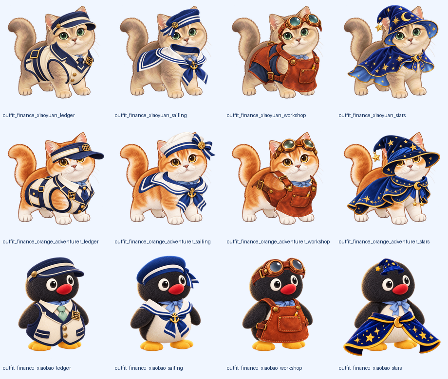

# 小圆冒险世界 · 原创公开版

把刷题变成小圆、小团、小宝一起参加的经营冒险。公开内容包含704道原创题、三科44章、128个主线关卡，财务成本管理20章440题；提供完整解析、公式卡、分小问计算、错题复习和本地备份。

三位主角、四位伙伴、六位NPC、十二套职业装、八件道具、六幕剧情、六栋三级建筑和十二项委托与学习进度联动。进度在各端独立保存；保存成功后才结算奖励，失败重试保留同一结果。



## 启动

要求Python3.11+和Node24。项目依赖已有锁文件。

桌面版：

```sh
python -m pip install -r requirements.txt
python src/main.py
```

网页及苹果代码候选：

```sh
cd ios-app
npm ci
npm run web
```

网页离线构建：在`ios-app`运行`npm run build:pwa`，将生成的`dist`部署到自己配置的HTTPS静态站点。部署目标和域名由维护者配置。

微信：将`miniprogram`导入微信开发者工具，先使用体验配置调试；需要上传自己的小程序时配置自己的AppID，按[微信发布流程](docs/RELEASE.md)检查实际包体、隐私指引和后台审核状态。

## 检查与维护

```sh
python scripts/sync_public_content.py
python scripts/check_public_release.py
python -m unittest discover -s tests -v
node --test tests/*.test.cjs
cd ios-app
npm test
npm run typecheck
npm run lint
npm run build:pwa
```

`content/original-bank.json`和`content/campaign.json`是公开题库与地图的主库。生成程序完整导出题干、答案、原解析、扩展讲解、来源、小问及数值判定字段。微信题库使用可复核的无损离线编码。

`tools/create_*`保留原创题目的编写与参数来源，供独立模型验证和维护；基础生成器会生成自己的内容范围，勿直接覆盖704题主库。修改主库前保留备份和稳定题号，再运行同步及检查。

题库维护见[机制与工作流](docs/MECHANISM.md)，发版见[发布步骤](docs/RELEASE.md)，GitHub操作见[上传指南](docs/GITHUB.md)，来源和许可见[第三方说明](THIRD_PARTY_NOTICES.md)。自动化工作流见`.github/workflows/ci.yml`。

公开题目保留简化情境的假设；新增财管题经过内部结构与独立数值检查。验收的具体范围见[验收状态](docs/VALIDATION.md)。原始教材、扫描题图、个人存档、参考照片与账号授权资料保留在维护者自己的私有库。

本仓库沿用项目已有MIT许可证。第三方库和其许可独立保留，见`LICENSE`、第三方说明及程序中的开源组件清单。

